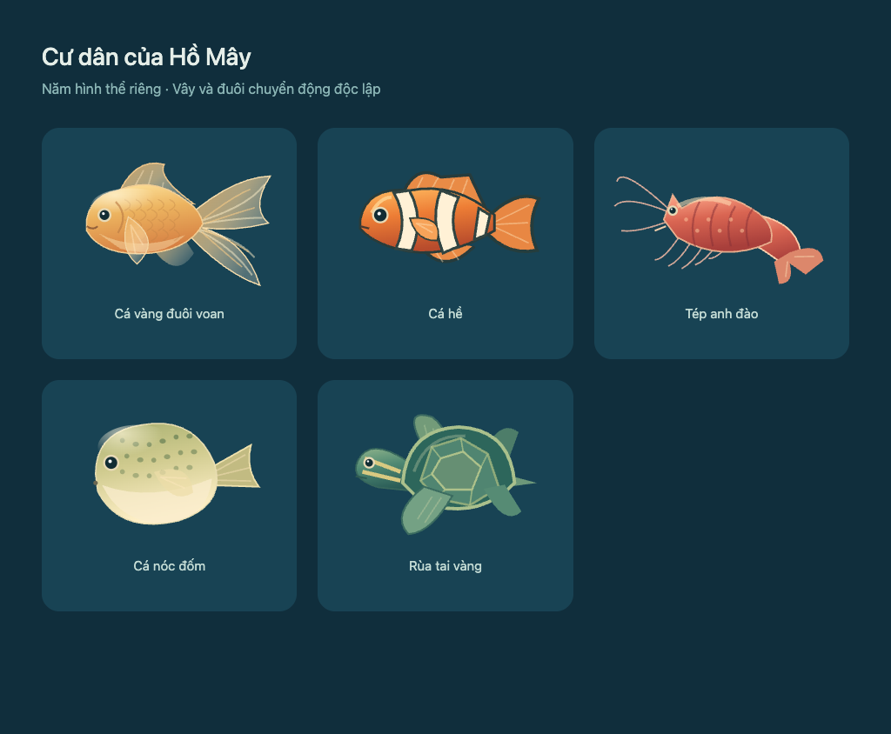

# Sổ Chi Tiêu

**[Xem demo hồ cá](https://hoangnguyen2004.github.io/money-aquarium/aquarium-demo.html)** · [Mở ứng dụng](https://hoangnguyen2004.github.io/money-aquarium/)

App quản lý chi tiêu cá nhân cho iPhone và Android (Expo / React Native).

- **Tổng quan** — số dư tháng, danh sách giao dịch, thêm/sửa/xóa.
- **Quét hóa đơn** — chụp hoặc chọn ảnh, app đọc số tiền, ngày, danh mục rồi điền sẵn vào form. Không có API key thì đọc ngay trên máy (ML Kit / Vision, cần bản cài đầy đủ, không chạy trong Expo Go hay bản web); có key thì AI đọc kỹ hơn.
- **Giao diện** — 5 bộ theme và ảnh nền chọn từ máy, đổi trong Cài đặt.
- **Báo cáo** — tự tổng hợp theo tháng: biểu đồ danh mục, chi theo ngày, so với tháng trước, nhận xét tự động, chia sẻ dạng chữ.
- **Kế hoạch** — thu nhập dự kiến, mục tiêu tiết kiệm, hạn mức từng danh mục, gợi ý phân bổ, dự báo cuối tháng.
- **Trợ lý** — bấm dấu cộng để mở, nhắn "cà phê 35k" là ghi. Không có API key vẫn chạy (chế độ cơ bản, offline); có key thì hiểu câu tự nhiên và ảnh hóa đơn.

## Hồ cá thư giãn

Hồ cá có 5 cư dân với hình minh họa và chuyển động riêng: cá vàng đuôi voan, cá hề, cá nóc đốm, tép anh đào và rùa tai vàng. Có cho ăn, đặt tên, tăng trưởng qua các ngày chăm sóc, trang trí, cửa hàng/kho và chế độ Chỉ ngắm.



Đây là bản thử nghiệm lưu dữ liệu cục bộ. Food wallet, rương, phối giống và đồng bộ tài khoản chưa được triển khai. Xem [đặc tả và bảng đối chiếu](docs/Money_Aquarium_Functional_Spec_v1.1.md).

## Cài đặt và chạy

Yêu cầu Node.js 22 và npm. Sau khi clone repo:

```bash
npm ci
npm run web
```

App không cần API key để chạy các chức năng cơ bản và hồ cá.

## Chạy trên điện thoại

1. Cài app **Expo Go** trên điện thoại (App Store / Google Play).
2. Máy tính và điện thoại cùng mạng Wi-Fi, rồi chạy:

   ```bash
   npx expo start
   ```

3. Quét mã QR hiện trong terminal (iPhone: dùng Camera; Android: quét trong Expo Go).

Chạy thử trên trình duyệt: `npm run web`.

## Bật tính năng AI

Mở **Cài đặt** (biểu tượng bánh răng ở tab Tổng quan) và dán Claude API key (tạo tại platform.claude.com).
Key lưu trong Keychain/Keystore của máy; mỗi lần quét hoặc nhắn AI tính phí vào tài khoản API của bạn.

## Cấu trúc

- `App.tsx` — khung app, thanh tab.
- `src/store.ts` — dữ liệu, lưu bằng AsyncStorage ngay trên máy.
- `src/report.ts` — thống kê, nhận xét, dự báo.
- `src/localBot.ts` — bot offline hiểu tiếng Việt.
- `src/ai.ts` — đọc hóa đơn và trợ lý qua Claude API.
- `src/ocr.ts`, `src/receipt.ts` — đọc hóa đơn trên máy; `npm test` chạy test bộ đọc.
- `src/theme.ts` — các bộ theme.
- `src/screens/`, `src/components/` — giao diện.


## Build bản demo chia sẻ

```bash
npm run build:demo
npx serve dist
```

- `/`: app với dữ liệu riêng của người dùng trên trình duyệt.
- `/aquarium-demo.html`: hồ mẫu có sẵn 5 cư dân, mở trực tiếp tab Hồ cá. Trang này đặt lại dữ liệu mẫu khi tải; dùng một trình duyệt/profile riêng nếu muốn thử cả app với dữ liệu của mình.
- `/aquarium-preview.html`: trang dành cho kiểm tra tự động, không dùng làm link demo.

Demo không chứa giao dịch hoặc API key cá nhân. Không nhập API key vào bản demo công khai. Dữ liệu app hiện được lưu trên thiết bị, chưa đồng bộ qua tài khoản.

## GitHub Pages

Workflow `.github/workflows/pages.yml` kiểm tra TypeScript/test, build web và xuất bản khi push nhánh `main`. Trong repo GitHub, vào **Settings → Pages → Source → GitHub Actions** để bật hosting. Workflow tự đặt đường dẫn nền theo tên repo, kể cả repo dạng `<user>.github.io`.

Sau khi workflow Deploy thành công, mở link Pages của repo và thêm `/aquarium-demo.html` để xem hồ mẫu. Thư mục `dist` được tạo khi build, không commit vào Git.

## Kiểm tra

```bash
npm run typecheck
npm test
```

Test UI tùy chọn trên macOS có Google Chrome:

```bash
npm run build:demo
node scripts/check-aquarium-web.mjs
```

Các hình minh họa cá hiện tại được vẽ bằng mã SVG; xem [manifest hình ảnh](docs/aquarium-art-manifest.md).
