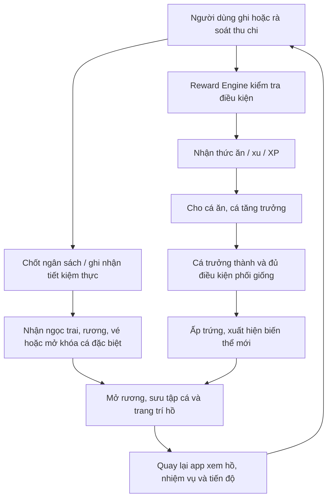

# ĐẶC TẢ CHỨC NĂNG – HỒ CÁ TÀI CHÍNH (MONEY AQUARIUM)

**Dự án:** Money Aquarium – Ứng dụng quản lý thu chi kết hợp hồ cá thư giãn  
**Phiên bản:** 1.1 – Đối chiếu triển khai và cập nhật hướng nuôi cá  
**Ngày:** 12/11/2026  
**Trạng thái:** Đặc tả đích + đối chiếu bản chạy cục bộ. Không coi các tính năng planned là đã triển khai.  
**Ưu tiên:** Mobile-first, hồ cá 2D nhìn ngang, minh họa vector nhiều lớp với chuyển động liên tục; kết nối dữ liệu ghi chép tài chính trong app.

---

## 0. Kết quả đối chiếu mã nguồn ngày 12/11/2026

**Quyết định từ yêu cầu người dùng:** bỏ trải nghiệm quán cà phê; tập trung hồ cá, cả ngắm thư giãn và vòng chơi chăm sóc/sưu tập. Không triển khai lại café theo các đoạn cũ của bản 1.0.

### 0.1. Các sai lệch chính đã xác định

| Nội dung bản 1.0 | Hiện trạng trước cập nhật | Quyết định bản 1.1 |
|---|---|---|
| Quán và hồ chung một game | Tab đã đổi thành Hồ cá, vật phẩm café không còn trong cửa hàng | Café ngoài phạm vi; khóa lưu `cafeName`, `served` và món cũ còn được giữ để đọc dữ liệu cũ, không phải tính năng đang hoạt động |
| Pixel art nhiều khung | Cá dùng một dáng oval chung, đổi màu; rùa/tép chưa khác hình thể | Minh họa vector riêng từng loài; vây, đuôi, chân/râu được tách phần; không dùng cùng silhouette để thay màu |
| Cá lớn lên thay đổi sprite/chi tiết | Chỉ đổi scale theo số ngày | Thêm khác biệt mắt/thân, vây, đuôi và họa tiết theo 3 giai đoạn, vẫn giữ luật ngày chăm sóc hiện có |
| Growth XP, food wallet, hai lần/cá/ngày | Một lần tăng ngày/cá/ngày; cho ăn miễn phí; chưa có food wallet | Giữ cơ chế đơn giản trong bản local, ghi rõ khác biệt; food/XP là planned, không hiển thị số dư giả |
| 12–20 loài, fish instance, cá trùng | 5 loại cư dân, mỗi loại tối đa một cá thể | Bản này làm sâu 5 loại trước; nhiều cá thể, biến thể và mở rộng danh mục là planned |
| Rương/server RNG, breeding, hatch | Chưa có backend hoặc UI tương ứng | Planned; không dựng nút giả hoặc tuyên bố đã có |
| Đồng bộ thiết bị | AsyncStorage, lưu cục bộ một thiết bị/trình duyệt | Chỉ cam kết save/reload cục bộ; tài khoản và cloud sync là planned |
| Ngân sách kỳ + ân hạn | Ngọc ngày được cấp khi rà soát; chốt tháng thủ công; chưa có pending/ân hạn | Ghi nhận khoảng thiếu nghiệp vụ, cần thay reward engine trước khi nghiệm thu ngân sách theo đặc tả đích |

### 0.2. Ma trận chức năng

`implemented` = có đường thao tác đang chạy; `partial` = có một phần nhưng chưa đạt đầy đủ yêu cầu 1.0; `planned` = chưa triển khai; `removed` = bỏ theo hướng sản phẩm mới.

| ID | Trạng thái | Bằng chứng / khoảng thiếu |
|---|---|---|
| AQ-001 | partial | `rules.start`: tạo hồ, 1 cá vàng miễn phí; chưa có bộ trang trí khởi đầu |
| AQ-002 | implemented | `AquariumView`, `ZenArt`, `sim/fish`: nhiều lớp nước, cá riêng loài, lá/bọt khí, tăng giảm tốc/quay đầu; chưa có benchmark điện thoại thật |
| AQ-003 | partial | Tap mở tên, loài, hình, mô tả, độ hiếm, ngày chăm sóc, tiến độ; chưa có biến thể/ghép cặp/instance |
| AQ-004 | partial | Cho ăn toàn hồ, cá tìm mồi, giới hạn 18 hạt đang có; chưa tiêu Food, chưa có growth XP |
| AQ-005 | partial | 3 giai đoạn theo ngày chăm sóc 0/3/7, không mất tiến độ; chưa theo XP 40/120 như đích |
| AQ-006 | partial | Cửa hàng/kho hiển thị cư dân và sở hữu; chưa có lưới biến thể/nguồn mở khóa/cá bí mật |
| AQ-007 | planned | Thưởng thu chi hiện có xu/XP; chưa cấp thức ăn hữu hạn |
| AQ-008 | partial | Ledger có khóa chống nhận trùng cục bộ; chưa có audit trạng thái và tính nguyên tử server |
| AQ-009 | planned | Chưa có rương và lịch sử mở |
| AQ-010 | partial | Hồ sơ có nhãn độ hiếm; chưa có drop rate hoặc cá trùng |
| AQ-011 | partial | Save/reload bằng AsyncStorage; chưa có tài khoản/đồng bộ đa thiết bị |
| AQ-012 | implemented | Mua, đặt ngang trong vùng hợp lệ, cất/thả, lưu vị trí đá/hoa sen |
| AQ-013–017 | planned | Chưa có phối giống, ấp, di truyền, cá thành tựu, mở khu vực |
| AQ-018 | partial | Gợi ý nhiệm vụ hôm nay có sẵn; chưa có nhiệm vụ động theo ngân sách |
| AQ-019 | removed | Bỏ NPC và hồ trong quán vì bỏ café |
| AQ-020 | planned | Chưa có sự kiện mùa |

### 0.3. Kiến trúc hiện có

- `src/types.ts`: giao dịch gồm `expense`/`income`, ngày, danh mục, số tiền; chưa có transfer/refund/pending/savings contribution riêng.
- `src/store.ts`: state giao dịch, kế hoạch thu nhập/tiết kiệm dự kiến, hạn mức danh mục, game; persist AsyncStorage, chưa có backend.
- `src/game/rules.ts`: thưởng, mua/cất/đặt tên, tiến độ chăm sóc; `cafeName` là khóa tương thích dữ liệu cũ.
- `src/game/species.ts`: hồ sơ loài, nhịp bơi, vùng sống và giai đoạn hình ảnh.
- `src/game/sim/fish.ts`: vị trí, vận tốc, steering, nghỉ, tìm/ăn mồi, tránh tụ chồng; không vẽ.
- `src/game/view/ZenArt.tsx`: artwork vector tự dựng, không dùng ảnh bên ngoài; `AquariumView.tsx`: scene và tương tác.
- `src/screens/AquariumScreen.tsx`: hồ, chi tiết, nhiệm vụ, cửa hàng, kho; chế độ Chỉ ngắm và Tạm dừng.

### 0.4. Phạm vi thay đổi được triển khai trong lượt cập nhật này

1. Giữ ID loài/ví/ledger và dữ liệu người dùng cũ.
2. Vẽ lại 5 cư dân: cá vàng đuôi voan, cá hề, cá nóc đốm, tép anh đào, rùa tai vàng. Rùa/tép có giải phẫu minh họa riêng, không tái dùng thân cá.
3. Tăng chi tiết vảy, mang, vây có tia, hoa văn, độ trong và sáng tối; tránh thêm particle che cá.
4. Phân biệt giai đoạn hình ảnh: cá nhỏ ít hoa văn và đuôi ngắn; cá non hiện vảy; cá trưởng thành hoàn thiện đuôi/vây, gai/hoa văn theo loài.
5. Phân biệt hành vi: cá hề nhanh hơn, cá nóc lơ lửng, tép đi sát đáy, rùa đạp chậm; tách nhịp chuyển động để cả đàn không vẫy đồng bộ.
6. Bổ sung hồ sơ loài và tiến độ trong panel cá; đồng nhất hình minh họa ở hồ/cửa hàng/kho.

**Lưu ý nội dung:** đây là hồ minh họa trong game, ghép cư dân từ nhiều hệ sinh thái. Không phải hướng dẫn ghép nuôi ngoài đời. Nhãn độ hiếm là độ hiếm trong game, không phải độ hiếm sinh học.

## 1. Mục tiêu và triết lý sản phẩm

Biến việc **ghi nhận thu chi → kiểm tra ngân sách → tiết kiệm theo mục tiêu** thành vòng lặp chăm sóc và xây dựng một hồ cá sống động. Người dùng không nhận thưởng vì *chi nhiều tiền*, mà vì duy trì thói quen tài chính lành mạnh, hiểu dòng tiền và tiến gần mục tiêu tiết kiệm.

Hệ thống hồ cá gồm: **sưu tập loài cá – mở rương/trứng – cho ăn/tăng trưởng – phối giống/biến thể – cá đặc biệt – trang trí/mở khu vực – nhiệm vụ tài chính**. Hồ cá là trải nghiệm game duy nhất, dùng chung dữ liệu ghi chép với ứng dụng tài chính. Quán cà phê đã được loại khỏi phạm vi.

### Nguyên tắc bắt buộc

1. Dữ liệu **Giao dịch** và **Kế hoạch** là nguồn sự thật về tài chính; game không được chỉnh sửa giao dịch.
2. Không thưởng tỉ lệ thuận với số tiền đã chi, không khuyến khích mua sắm hoặc nhập giao dịch giả.
3. Thưởng cho **tính đều đặn của việc ghi chép**, **rà soát** và **kết quả đạt ngân sách/tiết kiệm** theo hai nhóm tách biệt.
4. Không phạt bằng cách làm cá chết, mất cá hoặc mất đồ trang trí nếu người dùng nghỉ dùng app hoặc vượt ngân sách.
5. Mọi rương ngẫu nhiên dùng **tiền game kiếm được trong app**, không mua bằng tiền thật ở phiên bản đầu. Tỷ lệ từng độ hiếm phải công khai trong giao diện.
6. Những thành tích ngân sách chỉ chốt sau khi hết kỳ đánh giá và cho phép điều chỉnh giao dịch trong khoảng ân hạn.
7. Giá trị thưởng cụ thể phải cấu hình được ở backend, không hardcode trên giao diện.

## 2. Vòng lặp trải nghiệm cốt lõi

**Vòng lặp ngắn (1–3 phút/ngày):** vào app → ghi/kiểm tra thu chi → nhận thức ăn → cho cá ăn → xem tiến độ.  
**Vòng lặp tuần:** chốt ngân sách tuần → nhận rương → khám phá cá/trang trí mới.  
**Vòng lặp tháng:** xem báo cáo và kết quả kế hoạch → nhận rương lớn → mở khu vực/cá đặc biệt, tiến tới phối giống cá hiếm.

## 3. Điều hướng và màn hình

Tại tab **Hồ cá**, giữ các mục: `Hồ cá | Nhiệm vụ | Cửa hàng | Kho đồ`. Có `Chỉ ngắm` để thu gọn công cụ và `Tạm dừng` để dừng chuyển động. Không có mục Quán.

### UI-01. Màn hình Hồ cá (chính)

**Bố cục:**
- Top HUD: tên hồ, cấp hồ, XP, số xu, ngọc trai, số thức ăn, hộp thư thưởng.
- Vùng canvas 2D: mặt nước, đáy hồ, cây, bóng nước, cá bơi độc lập; cho phép chọn cá bằng tap.
- Công cụ nổi: `Cho ăn`, `Mở rương`, `Phối giống`, `Trang trí`, `Bộ sưu tập`.
- Thẻ nhiệm vụ ở đáy màn hình: hiển thị hành động tài chính tiếp theo, ví dụ “Rà soát chi tiêu hôm nay để nhận +2 thức ăn”.
- Trên mobile, các menu dùng bottom sheet; tránh che kín scene và có nút quay về.

**Trạng thái:** hồ mới chưa có cá, hồ có cá, loading, mất mạng, chưa có thức ăn, chưa mở phối giống, đang có trứng ấp, vừa mở khóa loài mới.

### UI-02. Chi tiết cá

Chạm cá → panel gồm: tên, hình động, loài, độ hiếm, biến thể màu, giới tính game (nếu dùng), cấp, giai đoạn phát triển, XP tăng trưởng, số lần cho ăn hôm nay, độ tương thích phối giống, nguồn nhận, nút `Cho ăn`, `Đặt tên`, `Chọn phối giống`.

### UI-03. Khu mở rương

Hiển thị rương sở hữu, rương khóa/chưa đủ điều kiện, tỷ lệ nhận từng độ hiếm, danh sách phần thưởng, lịch sử mở; có nút `Mở 1` và hoạt cảnh mở khóa. Trước khi mở hiển thị rõ tài nguyên dùng và xác suất.

### UI-04. Khu phối giống

Hai ô chọn cá bố/mẹ (hoặc hai cá ghép cặp); danh sách cặp hợp lệ; chi phí; các biến thể có thể sinh; điều kiện về trưởng thành, độ tương thích, thời gian ấp, số lượt còn lại. Có màn hình xác nhận trước khi bắt đầu.

### UI-05. Bộ sưu tập cá

Lưới loài và biến thể: sở hữu/chưa sở hữu, độ hiếm, mô tả, nguồn mở khóa (rương, phối giống, thành tựu tiết kiệm, sự kiện), số cá còn thiếu để hoàn thành bộ sưu tập. Chưa lộ toàn bộ hình của cá bí mật nếu muốn giữ yếu tố khám phá.

### UI-06. Cửa hàng & kho đồ

Bán nội thất hồ, cây, đá, nền, thức ăn tiêu hao, slot hồ (nếu phù hợp) bằng tiền game; thể hiện số đang sở hữu và xem trước trong hồ. Không hiển thị nút mua bằng tiền thật ở MVP.

### UI-07. Liên kết Kế hoạch

Khi xem mục tiêu ngân sách/tiết kiệm tại tab **Kế hoạch**, hiển thị phần thưởng game dự kiến và tiến độ đủ điều kiện. Nhấn `Xem phần thưởng` đưa về hồ cá; cập nhật khi có dữ liệu mới.

## 4. Danh mục chức năng (Functional Requirements)

| ID | Chức năng | Mô tả | Ưu tiên |
|---|---|---|---|
| AQ-001 | Khởi tạo hồ | Người dùng mới nhận hồ mặc định, 1 cá phổ thông và vài vật phẩm cơ bản | MVP |
| AQ-002 | Render hồ 2D | Cá là entity riêng, có chuyển động bơi/quay đầu/nghỉ; nước/cây/bọt khí động | MVP |
| AQ-003 | Chọn cá | Tap cá mở hồ sơ và các hành động | MVP |
| AQ-004 | Cho cá ăn | Dùng thức ăn trong ví, cộng XP tăng trưởng theo giới hạn ngày | MVP |
| AQ-005 | Tăng trưởng | Cá trải qua 3 giai đoạn: con → non → trưởng thành | MVP |
| AQ-006 | Bộ sưu tập | Xem loài đã mở, độ hiếm, nguồn nhận, tiến độ | MVP |
| AQ-007 | Nhận thức ăn từ thu chi | Ghi/rà soát giao dịch hợp lệ nhận thức ăn theo hạn mức | MVP |
| AQ-008 | Reward Engine | Xử lý sự kiện thu chi, ngân sách và tiết kiệm có chống nhận trùng | MVP |
| AQ-009 | Rương phần thưởng | Nhận rương khi hoàn thành nhiệm vụ tài chính, mở ra cá/vật phẩm | MVP |
| AQ-010 | Độ hiếm & vật phẩm trùng | Có rarity, tỷ lệ minh bạch, xử lý cá trùng | MVP |
| AQ-011 | Lưu trạng thái | Reload/đổi thiết bị không mất cá, thức ăn, xu, tiến độ | MVP |
| AQ-012 | Trang trí hồ | Đặt, di chuyển, cất vật phẩm trong khu hợp lệ | V2 |
| AQ-013 | Phối giống | Chọn 2 cá đủ điều kiện, sinh trứng theo bảng di truyền/độ hiếm | V2 |
| AQ-014 | Ấp trứng | Đếm giờ server, nở cá mới, hiệu ứng nở | V2 |
| AQ-015 | Biến thể di truyền | Màu/pattern/ánh sáng nhận từ bố mẹ; có biến thể bí mật | V2 |
| AQ-016 | Cá đặc biệt | Cá độc quyền từ mốc tiết kiệm, ngân sách, sự kiện | V2 |
| AQ-017 | Mở rộng hồ | Mở khu vực/địa hình/hệ sinh thái qua thành tựu | V2 |
| AQ-018 | Nhiệm vụ động | Gợi ý theo tình trạng ngân sách và nhịp nhập giao dịch | V2 |
| AQ-019 | Đã loại bỏ | Bỏ NPC và hồ trong quán theo quyết định bỏ café | Removed |
| AQ-020 | Sự kiện mùa | Loài theo mùa, trang trí giới hạn, nhiệm vụ đặc biệt | V3 |

## 5. Hệ thống cá và độ hiếm

### 5.1. Danh mục khởi tạo đề xuất

- **Phổ thông (Common):** cá bảy màu, cá neon, cá bình tích, cá mún.
- **Không phổ biến (Uncommon):** cá betta xanh, cá thiên thần, cá vàng đốm.
- **Hiếm (Rare):** cá koi ánh trăng, cá thủy tinh, cá đuôi sao.
- **Sử thi (Epic):** cá ngân hà, cá phượng hoàng nước (hư cấu).
- **Huyền thoại (Legendary):** cá rồng tinh tú, cá chép tài lộc (hư cấu).

Danh mục gồm cá thật và cá fantasy **được gắn nhãn rõ**. Có thể khởi chạy với 12–20 loài, sau đó bổ sung theo phiên bản.

### 5.2. Thuộc tính cá

- `fishInstanceId`: định danh cá cụ thể người dùng sở hữu.
- `speciesId`: loài.
- `variantId`: biến thể hình ảnh.
- `rarity`: cấp hiếm.
- `growthXp`, `growthStage`, `level`.
- `parents`: ID bố mẹ nếu sinh từ phối giống.
- `obtainedFrom`: starter/chest/breeding/achievement/event.
- `isSpecial`, `isPlaced`, `nickname`.

### 5.3. Tăng trưởng

**Ba giai đoạn:** `FRY` (cá con) → `JUVENILE` (cá non) → `ADULT` (trưởng thành).  
Ví dụ cân bằng: 0–39 XP, 40–119 XP, từ 120 XP trở lên; điều kiện có thể tăng theo độ hiếm. Cá lớn dần thay đổi sprite/scale/chi tiết đuôi, không chỉ phóng lớn ảnh.

- Cho ăn tiêu 1 thức ăn/lần; ví dụ +10 growth XP.
- Giới hạn **2 lần nhận XP từ thức ăn/cá/ngày**; người chơi vẫn có thể cho ăn mang tính thẩm mỹ không tốn tài nguyên hoặc không cộng XP nếu đạt trần.
- Không mở app không khiến cá chết hoặc bị giảm cấp; chỉ tạm ngừng tăng trưởng chủ động.
- Có thể bổ sung thức ăn đặc biệt từ sự kiện, nhưng không bán gói tăng trưởng bằng tiền thật ở MVP.

## 6. Mở rương và sinh cá mới

### 6.1. Các loại rương

| Loại | Nguồn nhận chính | Phần thưởng điển hình |
|---|---|---|
| Rương gỗ | Hoàn thành nhiệm vụ ghi chép/tuần đầu | Cá phổ thông, thức ăn, xu, nội thất |
| Rương bạc | Hoàn thành ngân sách tuần | Cá phổ thông–hiếm, vật phẩm trang trí |
| Rương vàng | Hoàn thành ngân sách tháng hoặc mốc tiết kiệm | Cá hiếm/sử thi, mảnh cá, trang trí đặc biệt |
| Rương thành tựu | Đạt mốc tiết kiệm thực hoặc thành tích dài hạn | Một phần thưởng đặc biệt xác định trước hoặc pool giới hạn |

Rương thành tựu nên **ưu tiên phần thưởng bảo đảm** (ví dụ cá độc quyền khi đạt mục tiêu), thay vì để mọi thành quả tiết kiệm phụ thuộc may rủi.

### 6.2. Cơ chế ngẫu nhiên minh bạch

Ví dụ cấu hình thử nghiệm cho **rương vàng** (không áp dụng máy móc cho mọi rương): Common 55%, Uncommon 28%, Rare 12%, Epic 4%, Legendary 1%. Tổng 100%; mỗi rương có bảng riêng, hiển thị trước khi mở.

- Mỗi rương mở một kết quả đã được server ghi nhận; animation chỉ trình diễn kết quả, không quyết định xác suất phía client.
- Có thể áp dụng **bảo hiểm mở rương (pity)**: sau 10 rương vàng không có Rare trở lên, rương thứ 10 bảo đảm ít nhất Rare. Bộ đếm và cách reset cần hiển thị công khai.
- Có thể ra cá trùng. Cá trùng được giữ để nuôi/phối giống hoặc **tự chọn** đổi thành mảnh nghiên cứu; không tự động phá hủy cá độc nhất.
- Chưa hỗ trợ chuyển đổi phần thưởng ra tiền thật, mua rương bằng tiền thật, hoặc giao dịch vật phẩm đổi tiền.

### 6.3. Hoạt cảnh mở rương

Chạm rương → xem điều kiện/tỷ lệ → xác nhận → rương rung nhẹ → mở nắp → ánh sáng theo cấp hiếm → cá hiện ra và bơi vòng → hiển thị `Cá mới!`/`Đã sở hữu` → nút `Thả vào hồ` hoặc `Để vào kho`.

## 7. Phối giống và tạo biến thể mới

### 7.1. Điều kiện

- Người dùng đạt cấp hồ yêu cầu (ví dụ cấp 4).
- Có hai **fish instance khác nhau**, đều ở trạng thái `ADULT`, không đang ấp/phối giống và nằm trong bảng tương thích.
- Có đủ tài nguyên game, ví dụ 80 Coins + 1 **Vé phối giống** (kiếm từ nhiệm vụ tài chính tuần/tháng; không dùng tiền thật).
- Mỗi cá giới hạn số lần phối giống theo chu kỳ; cooldown ví dụ 24 giờ/cá.
- Nếu thiết kế cặp huyết thống, chặn bố mẹ–con và anh chị em cùng cặp bố mẹ để tránh các kết hợp không mong muốn.

### 7.2. Quy trình

Chọn cá A + cá B → xem xác suất các nhóm kết quả có thể có → nhấn `Phối giống` → backend xác thực & trừ tài nguyên nguyên tử → sinh một trứng với mã kết quả server-side → hiển thị khay ấp → đủ thời gian (ví dụ 12–48h) → nhấn nở → tạo fish instance mới.

### 7.3. Di truyền dễ hiểu

- Đặc tính truyền được: màu chính, màu phụ, pattern vảy, hình đuôi, hiệu ứng glow.
- Mỗi cặp tương thích có **bảng kết quả**. Ví dụ cá betta xanh + cá betta đỏ có khả năng tạo biến thể tím; koi trắng + koi vàng có thể ra koi ánh kim.
- Một số biến thể bí mật chỉ xuất hiện khi bố/mẹ đáp ứng điều kiện thành tựu tài chính; ví dụ đã hoàn thành mục tiêu tiết kiệm đầu tiên.
- Không cho phép lai mọi cặp thành một loài ngẫu nhiên không hợp lý; các quy tắc do dữ liệu cấu hình điều khiển.
- Kết quả phải công bằng và không làm người dùng có nhu cầu chi tiêu nhiều hơn để tăng cơ hội.

### 7.4. Cá đặc biệt đề xuất

| Cá đặc biệt | Điều kiện tài chính mở khóa | Vai trò trong game |
|---|---|---|
| Cá Chép Tài Lộc | Hoàn thành mục tiêu tiết kiệm đầu tiên | Cá kỷ niệm, hiệu ứng ánh vàng |
| Cá Koi Kỷ Luật | Hoàn thành ngân sách tháng trong 3 tháng (không nhất thiết liên tiếp) | Cá có pattern đặc biệt |
| Cá Pha Lê | Hoàn thành mốc quỹ dự phòng được xác nhận | Mở biến thể ánh sáng |
| Cá Cầu Vồng | Phối giống thành công từ cặp tương thích + sở hữu thành tựu tuần | Biến thể màu độc quyền |
| Cá Sao Băng | Thử thách sự kiện được hoàn thành | Hiệu ứng phát sáng/đuôi sao |

Không đặt cá đặc biệt sau mục tiêu tài chính phi thực tế; mức độ khó điều chỉnh theo ngân sách và khả năng người dùng tự xác định.

## 8. Tích hợp bắt buộc với tab Thu chi và Kế hoạch

### 8.1. Mô hình sự kiện

`TransactionCreated` / `TransactionUpdated` / `TransactionDeleted` / `DailyReviewCompleted` / `NoTransactionDayConfirmed` / `BudgetPeriodClosed` / `SavingsContributionConfirmed` / `SavingsMilestoneReached`.

**Lưu ý:** Giao dịch được tạo không có nghĩa là chi tiêu tốt; sự kiện này chỉ dùng cho thưởng **thói quen ghi nhận** với hạn mức ngày.

### 8.2. Bảng thưởng mẫu (configurable)

| Hành động tài chính | Điều kiện tính | Game reward |
|---|---|---|
| Ghi giao dịch đầu tiên trong ngày | Giao dịch hợp lệ, không phải trùng/cancel | +10 Coins, +5 XP, +3 thức ăn, tối đa 1 lần/ngày |
| Rà soát thu chi hôm nay | Người dùng xác nhận danh sách giao dịch đầy đủ hoặc không phát sinh | +10 Coins, +2 thức ăn, tối đa 1 lần/ngày |
| Không phát sinh giao dịch | Xác nhận ngày không có khoản thu/chi, không cần tạo dòng 0đ | Thưởng rà soát như trên |
| Đạt ngân sách ngày | Có ngân sách ngày đã thiết lập, chốt sau ngày kết thúc và ân hạn | +1 Pearl; không áp dụng nếu ngân sách chưa thiết lập |
| Đạt ngân sách tuần | Dựa trên danh mục áp dụng, đã rà soát kỳ | 1 rương bạc + 3 Pearls |
| Đạt ngân sách tháng | Tổng chi thực tế nằm trong ngân sách đã thiết lập, kết thúc kỳ và kiểm tra | 1 rương vàng + 10 Pearls |
| Ghi nhận tiết kiệm thực tế | Có dòng chuyển sang mục tiêu tiết kiệm/quỹ (không coi là chi phí tiêu dùng) | Cập nhật tiến độ mục tiêu, không thưởng theo từng lần chuyển nhỏ |
| Đạt mốc tiết kiệm 25/50/75/100% | Xác nhận số dư mục tiêu theo logic sản phẩm | Mở vật phẩm/khu vực/cá thành tựu một lần/mốc |
| 7 ngày có rà soát hợp lệ | Có thể bổ sung ngày bỏ sót trong ân hạn | 1 vé phối giống (V2) |

**Không thưởng** trực tiếp theo tổng tiền thu, tổng tiền chi, số giao dịch không giới hạn, hoặc số tiền “chưa xài hết”. Khoản tiền tiết kiệm chỉ được ghi nhận khi có bản ghi đóng góp/balance mục tiêu thật, tránh đếm hai lần.

### 8.3. Phân biệt ngân sách và mục tiêu tiết kiệm

- **Ngân sách:** ngưỡng chi tiêu dự kiến cho kỳ. Ví dụ ngân sách ăn uống 3.000.000đ, đã chi 2.700.000đ → đạt ngân sách; **300.000đ chưa chi không tự động thành tiền tiết kiệm**.
- **Tiết kiệm:** mục tiêu có số dư/đóng góp xác nhận. Ví dụ chuyển 200.000đ vào quỹ du lịch; tiến độ quỹ tăng 200.000đ. Transfer nội bộ không tự biến thành chi phí.
- Nếu có hoàn tiền, hoàn trả, chuyển nội bộ, giao dịch pending hoặc bị xóa thì tính theo quy tắc sổ sách đã định nghĩa, không cộng lặp.

### 8.4. Điều kiện chốt thưởng

- Reward thói quen: có thể cấp ngay, nhưng tính tối đa một lần/ngày theo loại sự kiện.
- Reward ngân sách ngày/tuần/tháng: ở trạng thái `PENDING` đến khi kết thúc kỳ + ân hạn điều chỉnh (ví dụ 48h) rồi mới `GRANTED`.
- Nếu người dùng sửa/xóa giao dịch trong kỳ chưa chốt, tự tính lại; nếu đã chốt mà có sửa quá hạn, ghi dấu `ADJUSTMENT_REQUIRED` và xử lý theo chính sách điều chỉnh minh bạch, không âm thầm xóa cá/vật phẩm đã cấp.
- Thiếu giao dịch không phải bằng chứng rằng người dùng chi tiêu bằng 0; nên ưu tiên điều kiện đã xác nhận rà soát kỳ.
- Người dùng không có ngân sách cấu hình vẫn kiếm được thức ăn, xu và XP từ thói quen; không bị loại khỏi game.

### 8.5. Mẫu hành trình thực tế

1. Người dùng ghi khoản **cà phê 35.000đ** trong tab Tổng quan → nhận 3 thức ăn + 10 Coins + 5 XP (nếu là giao dịch đầu tiên hợp lệ trong ngày).
2. Vào tab Hồ cá → kéo/thả thức ăn vào hồ → cá bơi tới và nhận growth XP.
3. Cuối ngày rà soát chi tiêu → nhận thêm 2 thức ăn.
4. Cuối tuần, nếu ngân sách đã đặt được đáp ứng và dữ liệu được xác nhận → nhận rương bạc, mở được cá mới.
5. Khi chuyển khoản tiết kiệm vào mục tiêu du lịch và đạt **50%** → mở hồ sen hoặc cá đặc biệt theo bảng thành tựu.
6. Nuôi hai cá đủ trưởng thành → dùng vé phối giống từ nhiệm vụ tài chính → ấp trứng và mở biến thể mới.

## 9. Hoạt cảnh & tương tác hình ảnh

**Art direction bản 1.1:** 2D nhìn ngang, minh họa vector nhiều lớp, nền nước xanh sâu, ánh sáng xanh ngọc; chủ thể có chất liệu, cấu trúc vây/đuôi, hoa văn và silhouette riêng. Giữ renderer React Native SVG hiện có để các bộ phận chuyển động độc lập, không bắt buộc pixel art. Tránh cá kiểu oval + tam giác dùng lại cho mọi loài. Không vẽ cá cố định trong nền rồi chồng entity lên.

**Tiêu chí hình ảnh bổ sung:** nhận ra 5 cư dân qua silhouette không cần nhãn; cá vàng có đuôi voan chia thùy, cá hề có ba khoang trắng viền tối, cá nóc có thân tròn/bụng sáng/chấm, tép có đốt/râu/chân, rùa có mai/đầu/bốn chân. Vây chuyển động lệch pha; khi tạm dừng mọi bộ phận đứng yên. Giai đoạn phát triển thay đổi chi tiết chứ không chỉ phóng ảnh. Chuẩn này áp dụng đồng nhất cho scene, icon kho và panel hồ sơ.

- Cá: chuyển động liên tục theo đồng hồ scene, mục tiêu render tối đa 60 FPS; tốc độ và chu kỳ vây riêng từng loài, rẽ tự nhiên, tăng/giảm tốc, nghỉ, phản ứng chạm. FPS thực tế phải đo trên thiết bị, không coi mục tiêu là kết quả benchmark.
- Thức ăn: hạt rơi từ vị trí tap, cá có định hướng tìm đến, có hoạt cảnh ăn và tim/bong bóng.
- Tăng trưởng: hiệu ứng sáng, chuyển sprite theo giai đoạn, thông báo `Trưởng thành!`.
- Rương: rung, bật nắp, ánh sáng khác nhau theo cấp hiếm; có `Skip animation`.
- Trứng: lắc nhẹ, nứt vỏ, cá mới bơi ra, thẻ thông tin; timer theo server.
- Phối giống: hai cá bơi quanh nhau, trái tim/bọt sáng xuất hiện, trứng vào khay ấp.
- Môi trường: ánh sáng xuyên mặt nước, bọt khí, lá rung, sóng nhẹ; giới hạn particle trên mobile.
- `prefers-reduced-motion`: giảm/tắt hiệu ứng không thiết yếu; hỗ trợ thao tác keyboard ở panel React.

## 10. Kinh tế game, cân bằng và chống lạm dụng

- Nguồn Coins: ghi chép, rà soát, nhiệm vụ tài chính; nguồn Pearls: kết quả ngân sách/tiết kiệm; nguồn thức ăn: chăm sóc thói quen; vé phối giống: nhiệm vụ dài hạn.
- Sinh cá mới: rương/thành tựu/phối giống; không khuyến khích nhập giao dịch nhiều lần.
- Chi phí trang trí dùng Coins; phối giống dùng Coins + vé, thời gian ấp; không dùng tiền thật.
- Một tài khoản có thể có nhiều fish instance cùng loài; giới hạn số cá **được thả trong hồ** theo sức chứa để giữ FPS, cá dư ở kho chứ không mất.
- Độ hiếm tác động ngoại hình, hiệu ứng và khả năng sưu tập, **không mang lại quyền lợi tài chính thật**.
- Không bảng xếp hạng dựa trên tiền chi/tiền tiết kiệm tuyệt đối; nếu có chia sẻ, chỉ chia sẻ hồ và thành tựu tùy chọn.
- Mở rương phải ghi `rewardDrawId`, random seed/result tại server, bảng drop rate version và lịch sử giao dịch tài nguyên.

## 11. Quy tắc nghiệp vụ quan trọng

| Mã | Quy tắc |
|---|---|
| BR-AQ-01 | Reward được cấp tối đa 1 lần theo `(userId, eventType, periodKey)` nếu được cấu hình per-period |
| BR-AQ-02 | Số tiền giao dịch không làm tăng số thức ăn/XP; mọi cấp thưởng có trần |
| BR-AQ-03 | Ngân sách không cấu hình thì không có đánh giá “đạt ngân sách” |
| BR-AQ-04 | Kỳ ngân sách phải đóng + kết thúc ân hạn mới cấp thưởng kết quả |
| BR-AQ-05 | Ghi nhận tiết kiệm dựa trên chuyển/đóng góp quỹ, không dựa trên chi thấp hơn ngân sách |
| BR-AQ-06 | Tài nguyên bị trừ và vật phẩm/cá được cấp trong cùng transaction backend |
| BR-AQ-07 | Không thể nhận hai lần do double click, retry request hoặc event phát lại |
| BR-AQ-08 | Cá không chết/biến mất do người dùng bỏ app hoặc vượt ngân sách |
| BR-AQ-09 | Trứng đang ấp tính tiến độ theo timestamp server, không theo canvas loop |
| BR-AQ-10 | Chỉ cá trưởng thành và thuộc bảng tương thích mới được phối giống |
| BR-AQ-11 | Tỷ lệ rương và bảng phối giống do server cấu hình/version, công khai với người chơi |
| BR-AQ-12 | Reward Ledger ghi event nguồn, kỳ, trạng thái và điều chỉnh; có audit trail |
| BR-AQ-13 | Hồ và game state thuộc từng người dùng, không lấy dữ liệu người khác |
| BR-AQ-14 | Quỹ tiết kiệm/hồ cá không hiển thị số dư thật khi chia sẻ với bạn bè |

## 12. Mô hình dữ liệu đề xuất

Tận dụng các bảng giao dịch, kế hoạch và savings goal hiện có; không sao chép thông tin tài chính vào game ngoài ID tham chiếu cần thiết.

| Entity/table | Trường chính đề xuất |
|---|---|
| `game_profiles` | `user_id`, `level`, `xp`, `active_scene`, `created_at` |
| `game_wallets` | `user_id`, `coins`, `pearls`, `food`, `breeding_tickets`, `updated_at` |
| `fish_species` | `id`, `name`, `rarity`, `family`, `asset_key`, `growth_config`, `is_fantasy` |
| `fish_variants` | `id`, `species_id`, `colors`, `pattern`, `asset_key`, `is_secret` |
| `owned_fish` | `id`, `user_id`, `species_id`, `variant_id`, `nickname`, `growth_xp`, `stage`, `parent_a_id`, `parent_b_id`, `obtained_from`, `placed_slot` |
| `chest_definitions` | `id`, `name`, `drop_table_version`, `guarantee_rules`, `unlock_rule` |
| `owned_chests` | `id`, `user_id`, `definition_id`, `earned_from_event_id`, `opened_at` |
| `chest_open_results` | `id`, `chest_id`, `user_id`, `reward_payload`, `drop_table_version`, `created_at` |
| `breeding_jobs` | `id`, `user_id`, `parent_a_id`, `parent_b_id`, `egg_result_payload`, `ready_at`, `claimed_at`, `status` |
| `reward_ledger` | `id`, `user_id`, `source_event_id`, `event_type`, `period_key`, `reward_payload`, `status`, `idempotency_key`, `created_at` |
| `daily_care_log` | `user_id`, `date`, `fish_id`, `growth_feeds_count`, `last_fed_at` |
| `aquarium_layouts` | `user_id`, `area_id`, `decoration_positions`, `scene_settings`, `updated_at` |
| `game_missions` | `id`, `user_id`, `type`, `period_key`, `progress`, `status`, `reward_payload` |

Thêm unique constraints cho `reward_ledger.idempotency_key`, `chest_open_results.chest_id`, và các khóa phù hợp; transaction server-side dùng row lock/atomic update cho tài nguyên. Không để client truyền số Coins/Pearls/food “mới” như nguồn sự thật.

## 13. API/service contract gợi ý

- `GET /api/game/aquarium` – hồ, cá đang thả, bố cục, ví, nhiệm vụ.
- `GET /api/game/fish/catalog` – loài, rarity, điều kiện unlock.
- `POST /api/game/fish/:id/feed` – cho ăn (kiểm tra trần, trừ thức ăn, cộng XP).
- `POST /api/game/aquarium/place-fish` – thả/cất cá.
- `GET /api/game/chests` – danh sách và tỷ lệ các rương.
- `POST /api/game/chests/:id/open` – mở rương, server quyết định kết quả theo phiên bản drop table.
- `POST /api/game/breeding/preview` – xác thực 2 cá và hiển thị điều kiện/chi phí/tỷ lệ.
- `POST /api/game/breeding/start` – tạo trứng với giao dịch nguyên tử.
- `POST /api/game/breeding/:id/claim` – nhận cá sau khi ấp hoàn tất.
- `GET /api/game/missions` – tiến độ từ thu chi/kế hoạch.
- `POST /api/game/missions/daily-review` – xác nhận rà soát hoặc ngày không phát sinh.
- `GET /api/game/rewards/history` – lịch sử thưởng và điều chỉnh.
- `PATCH /api/game/aquarium/layout` – lưu bố cục trang trí theo quyền sở hữu.

Đường dẫn chỉ là đề xuất; khi tích hợp cần tuân theo kiến trúc backend hiện hành.

## 14. Tiêu chí nghiệm thu (Acceptance Criteria)

1. Người dùng mới nhận 1 hồ và 1 cá mà không cần tạo giao dịch giả.
2. Mỗi ngày ghi giao dịch hợp lệ đầu tiên chỉ nhận thưởng một lần; tạo 20 giao dịch không tăng thưởng này.
3. Một ngày không giao dịch có thể hoàn thành nhiệm vụ rà soát qua xác nhận “Không phát sinh”.
4. Cá có thể bơi, chọn, cho ăn; một cá không nhận vượt quá 2 lần growth XP/ngày theo cấu hình mẫu.
5. Đích: cá thay đổi giai đoạn đúng ngưỡng XP; bản local hiện dùng ngày chăm sóc 0/3/7. Ở cả hai cơ chế, thay đổi được chi tiết hình ảnh và không giảm cấp khi người dùng vắng mặt.
6. Mở rương ghi kết quả cố định tại backend trước animation; reload giữa hoạt cảnh không được rút lại rương hoặc cấp hai lần.
7. Rương hiển thị xác suất trước khi mở, độ hiếm/tỷ lệ cộng đủ 100%.
8. Sở hữu cá trùng vẫn có lựa chọn giữ lại hoặc chuyển mảnh nghiên cứu.
9. Chỉ hai cá trưởng thành tương thích, đủ tài nguyên mới bắt đầu phối giống.
10. Hết thời gian ấp theo server, người dùng nhận một cá đúng kết quả đã được lưu; claim hai lần không nhân đôi cá.
11. Chỉ ngân sách đã thiết lập và chốt kỳ mới xét cấp rương ngân sách; vượt ngân sách không xóa cá đã có.
12. Số ngân sách chưa chi không được tự động ghi là tiền đã tiết kiệm.
13. Đạt một mốc quỹ tiết kiệm chỉ mở khóa phần thưởng thành tựu một lần, kể cả khi có nhiều khoản đóng góp.
14. Giao dịch sửa/xóa trong ân hạn khiến phần thưởng đang pending tính lại; lịch sử có thể đối soát.
15. Đổi scene/reload/đăng nhập thiết bị khác không mất trạng thái đã đồng bộ.
16. UI không phô bày số tiền/thu nhập riêng tư trong chế độ chia sẻ hồ cá.
17. FPS và bộ nhớ nằm trong ngưỡng chấp nhận trên mobile; giới hạn cá đang render, giảm particle khi cần.

## 15. Phạm vi triển khai

### MVP – Làm trước

- Hồ cá 2D đẹp và sống động, 5–8 cá khởi đầu, cá bơi/cho ăn/tăng trưởng.
- Sưu tập cá, 2 loại rương, phần thưởng cá trùng, nhiệm vụ giao dịch/rà soát/đạt ngân sách.
- Wallet Coins/Pearls/Food, Reward Engine, audit/idempotency, persistence.
- Kết nối màn hình Thu chi và Kế hoạch; trạng thái thưởng chờ/chốt.

### V2 – Tăng chiều sâu

- Phối giống, ấp trứng, biến thể màu/pattern, hệ cá đặc biệt.
- Mở khu vực hồ và trang trí; thêm rương vàng, ngọc trai và quỹ tiết kiệm thành tựu.
- Nhiệm vụ thông minh, bộ sưu tập nhiều loài và vật phẩm.

### V3 – Mở rộng cộng đồng

- Sự kiện mùa, chia sẻ cảnh hồ mà không chia sẻ số tiền; không có khách ghé quán.
- Thêm vùng sinh thái, nhiệm vụ khám phá và album bộ sưu tập.

## 16. Các tình huống cần thử nghiệm trước khi phát hành

- Ngày đầu dùng app, chưa có ngân sách, vẫn có trải nghiệm game tích cực.
- Người dùng có giao dịch thu nhưng không chi: thưởng thói quen vẫn hoạt động, ngân sách không tự “thành công”.
- Người dùng chi vượt mức vì chi thiết yếu đột xuất: không bị phạt cá, có nhiệm vụ xem lại và điều chỉnh kế hoạch.
- Tháng có refund/transfer: tính đúng chi phí ròng theo rule tài chính của app; không cộng tiết kiệm sai.
- Người dùng sửa giao dịch cũ sau khi mở rương: không âm thầm xóa cá; tạo audit/điều chỉnh theo chính sách.
- Nhấn mở rương hai lần, mất mạng giữa mở rương, reload lúc trứng nở: không trùng phần thưởng.
- Người dùng đã có quá nhiều cá: cá mới vào kho, không mất; giới hạn số con bơi đồng thời để giữ hiệu năng.
- Dùng cùng tài khoản trên hai thiết bị: reward/feeding/breeding nguyên tử, nhất quán.

---

## 17. Yêu cầu triển khai tiếp theo (đặc tả đích, chưa mặc định hoàn thành)

1. Đọc cấu trúc codebase, chỉ ra mô hình giao dịch/ngân sách/tiết kiệm hiện có trước khi tích hợp.
2. Tách game state và rendering; dùng bộ minh họa vector nhiều lớp nhất quán ở bản 1.1; không dùng silhouette chung đổi màu cho mọi loài.
3. Triển khai MVP end-to-end trước: `transaction/review → reward → food → fish growth`, và `period close → chest → new fish`.
4. Tạo database migration, API, transaction/unique constraint, cấu hình reward/drop rate; không hardcode số dư client.
5. Tạo test cho idempotency, save/reload, điều chỉnh dữ liệu tài chính, mở rương và cho ăn.
6. Chỉ đánh dấu tính năng hoàn thành sau khi đã chạy thử UI và logic. Các tính năng phối giống/cá hiếm chưa triển khai phải được ghi `planned` thay vì dựng UI giả.
7. Dùng ảnh/asset người dùng sở hữu hoặc có giấy phép phù hợp; lập asset manifest khi thiếu sprite.

**Nguyên tắc sản phẩm cuối cùng:** Ghi chép và rà soát tài chính là cách người dùng **chăm sóc cá**, còn tiết kiệm thực tế và hoàn thành kế hoạch là cách họ **khám phá cá mới, lai tạo biến thể và phát triển hồ**. Game phải khiến người dùng quay lại vì niềm vui, không khiến họ chi tiền nhiều hơn hoặc cảm thấy bị trừng phạt khi tài chính khó khăn.

## 18. Thứ tự triển khai tiếp theo và cổng nghiệm thu

1. **Hình ảnh/hành vi (lượt này):** đủ 5 silhouette, chi tiết, nhịp bơi, tránh tụ chồng, giai đoạn hình ảnh, hồ sơ loài. Typecheck + test mô phỏng + kiểm tra UI mobile/tablet. Chưa tuyên bố đạt FPS trên máy thật.
2. **Vòng chăm sóc:** thêm Food vào ví/ledger, thưởng food từ transaction/review, growth XP và giới hạn ngày theo từng fish instance. Cần migration từ `fishCare.days`, giữ toàn bộ cá/tiến độ cũ.
3. **Chốt kỳ:** mô hình pending/granted/adjustment và ân hạn, rà soát kỳ; không dựa vào số chưa chi để tạo tiết kiệm.
4. **Rương và nhiều cá thể:** model instance, inventory capacity, drop table version, kết quả cố định và idempotency; trước khi mở phải có backend hoặc mô tả rõ chỉ là local prototype.
5. **Tài khoản/đồng bộ:** API, database/unique constraint, đồng bộ hai thiết bị, xử lý offline và retry.
6. **Phối giống/ấp:** chỉ thực hiện sau instance + backend; không tạo màn hình hứa hẹn một cơ chế chưa chạy.

Các yêu cầu server, rương, food wallet, cloud sync trong phần 1–17 là **đích sản phẩm**, phải đối chiếu bảng trạng thái ở mục 0 trước khi báo cáo hoàn thành.

## 19. Xác minh bản cập nhật

- `npm run typecheck`: PASS.
- `npm test`: PASS (receipt, game rules, fish simulation, legacy café simulation còn giữ trong repo).
- `npx expo export --platform web`: PASS.
- `node scripts/check-aquarium-web.mjs`: PASS ở 390px và 1024px: năm cư dân render, không tràn ngang, feeding/persistence, chống tăng trưởng lặp trong ngày, pause/resume, Chỉ ngắm, hồ sơ loài/tiến độ, cửa hàng/kho chỉ có hồ cá.
- Minh họa và nguồn: `docs/aquarium-art-manifest.md`. Ảnh kiểm tra: `shots/aquarium-species.png`, `shots/aquarium-normal-390.png`, `shots/aquarium-normal-1024.png`.
- Chưa kiểm tra trên điện thoại thật, chưa benchmark FPS/pin; không coi bản này đã nghiệm thu backend, rương, food wallet hay đồng bộ thiết bị.
